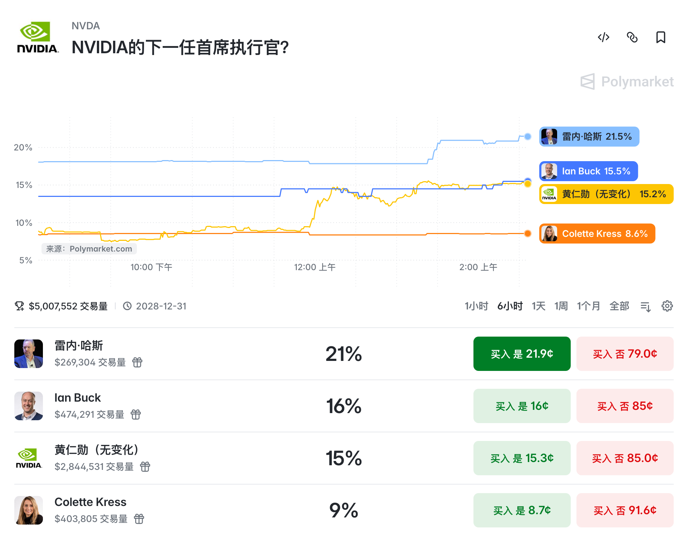
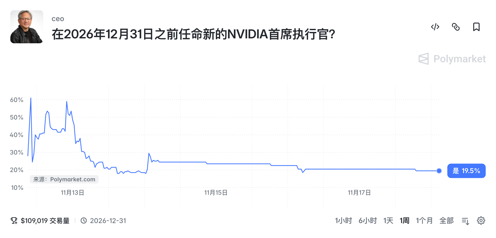

# Polymarket Screenshot Generator

粘贴一个 Polymarket 市场链接，生成一张可以直接发到社交媒体的走势图 PNG。

**在线使用：<https://wolfyxbt.github.io/polymarket-screenshot-generator/>**

[English](#english)



## 它解决什么问题

Polymarket 市场页的走势图把图例（每条线是谁、现在多少概率）放在图的左上角，读图的人要在线和图例之间来回对照。截图发出去以后，这一步对读者更费劲。

这个工具保留 Polymarket 市场卡片原本的版式，只改一处：**把图例挪到每条线的末端**。线尾是一个和线同色的标签，里面是选项头像、名字和当前概率，线挤在一起时标签会自动上下错开。

## 怎么用

1. 打开[在线页面](https://wolfyxbt.github.io/polymarket-screenshot-generator/)。
2. 粘贴市场链接，例如 `https://polymarket.com/event/next-ceo-of-nvidia`，点"生成"。
3. 按需要调整，然后点"复制图片"或"下载 PNG"。

可以调整的内容：

| 选项 | 说明 |
|---|---|
| 时间范围 | 1 小时、6 小时、1 天、1 周、1 个月、全部 |
| 选项数 | 画概率最高的前 1–8 个选项 |
| 语言 | 中文或英文（标题、选项名用 Polymarket 自己的翻译） |
| 选项列表 | 是否带上走势图下面的选项列表 |
| 修改文字 | 改标题、分类、选项名；改过的内容按市场记在浏览器里 |

支持的链接形式：`/event/<slug>`、`/event/<slug>/<market>`、带语言前缀的 `/zh/event/…`、`/market/<slug>`，也可以只填 slug。

只有"是 / 否"两个结果的市场会画一条"是"的线：



### 用地址栏参数直接出图

```
https://wolfyxbt.github.io/polymarket-screenshot-generator/?url=https://polymarket.com/event/next-ceo-of-nvidia&interval=1w&top=4&lang=zh&rows=1
```

| 参数 | 取值 |
|---|---|
| `url` | 市场链接或 slug |
| `interval` | `1h`、`6h`、`1d`、`1w`、`1m`、`max` |
| `top` | `1`–`8` |
| `lang` | `zh`、`en` |
| `rows` | `0` 不带选项列表，其他值带 |

## 工作原理

整个工具是一个 [index.html](index.html)，没有后端，没有构建步骤，也不调用任何 AI 模型。

- **取数**：浏览器直接请求 Polymarket 的公开接口，不需要登录或密钥。市场信息来自 `gamma-api.polymarket.com`，价格历史来自 `clob.polymarket.com/prices-history`。
- **画图**：整张卡片是用 JavaScript 拼出来的一个 SVG。
- **导出**：把 SVG 画到 canvas 上，按 2 倍清晰度导出 PNG。
- **头像**：Polymarket 的图片不允许别的网页直接读取像素，所以导出时头像会经公共图片代理 [wsrv.nl](https://wsrv.nl) 中转一次。经过代理的只有头像图片的地址。
- **本地存储**：上次的设置和你改过的文字存在浏览器的 `localStorage` 里，不会上传。

## 已知限制

- 你的网络要能访问 `polymarket.com`。打不开 Polymarket 的网络环境下，这个页面也取不到数据。
- 标题上方的分类，Polymarket 页面显示的是"大类 · 标签"（如 `Finance · NVDA`），但公开接口只提供标签。需要大类时在"修改文字"里补一次，之后会记住。
- 为了给线尾标签留位置，纵轴刻度放在了左边（Polymarket 页面在右边）。
- "复制图片"依赖浏览器的剪贴板接口，浏览器不支持时请用"下载 PNG"。
- 已结束或已下架的选项不会画出来。

## 本地运行

把仓库下载下来，在目录里起一个静态服务器即可：

```bash
python3 -m http.server 8000
```

然后打开 <http://localhost:8000>。直接双击 `index.html` 也能生成和下载，但"复制图片"在 `file://` 下不可用。

## 部署到自己的 GitHub Pages

Fork 这个仓库，在 Settings → Pages 里把 Source 选成 `Deploy from a branch`，分支选 `main`、目录选 `/ (root)`，保存后一两分钟就能访问。

## 免责声明

这是一个非官方的第三方工具，与 Polymarket 没有任何关联，也没有得到 Polymarket 的认可或赞助。

- 生成的图片用的是 Polymarket 的公开数据，并沿用了 Polymarket 市场页的版式。Polymarket 的名称、字标和图标是其所有者的商标或作品，在这里只用于标明数据来源，不在本仓库的开源授权范围内。
- 生成的图片不是 Polymarket 官方页面的截图：线尾标签是本工具加的。请不要把它当作官方截图来表述。
- 图片里的内容只是市场数据的呈现，不构成投资建议。

## 授权

- 本仓库的代码以 [MIT License](LICENSE) 发布。
- 页面里嵌入的 Inter 字体以 SIL Open Font License 1.1 发布，见 [licenses/OFL-Inter.txt](licenses/OFL-Inter.txt)。
- 第三方内容的说明见 [NOTICE.md](NOTICE.md)。

---

## English

Paste a Polymarket market link and get a share-ready PNG of its price chart.

**Live: <https://wolfyxbt.github.io/polymarket-screenshot-generator/>**

It keeps the layout of Polymarket's market card and changes one thing: the legend moves from the top-left corner to the **end of each line**, as a label in the line's colour holding the outcome's avatar, name and current probability.

- A single static `index.html`. No backend, no build step, no AI calls.
- Data comes straight from Polymarket's public APIs (`gamma-api.polymarket.com`, `clob.polymarket.com`); no login or API key.
- The card is drawn as an SVG and exported as a 2× PNG. Avatars are routed through the public image proxy [wsrv.nl](https://wsrv.nl) during export, because Polymarket's image host does not allow cross-origin pixel access.
- Time range, number of outcomes, language (Chinese / English), the outcome list, and all text are adjustable. Settings can also be passed as URL parameters: `?url=…&interval=1w&top=4&lang=en&rows=1`.

The page UI is in Chinese; the generated image can be in English (`lang=en`).

**Disclaimer.** This is an unofficial third-party tool, not affiliated with or endorsed by Polymarket. Polymarket's name, wordmark and icons belong to their owner, are used only to credit the data source, and are not covered by this repository's licence. Generated images are not screenshots of Polymarket's site and should not be presented as such. Nothing here is investment advice.

Code is released under the [MIT License](LICENSE); the embedded Inter font under the [SIL OFL 1.1](licenses/OFL-Inter.txt). See [NOTICE.md](NOTICE.md) for third-party material.
